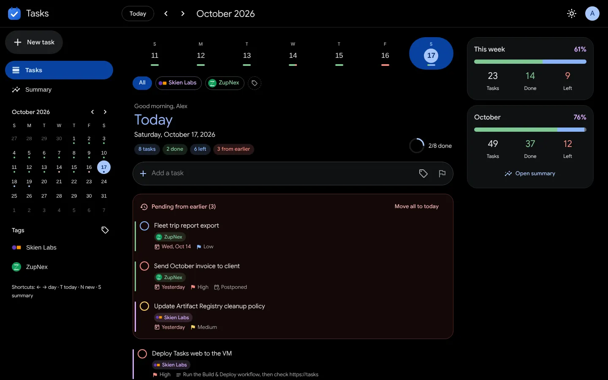
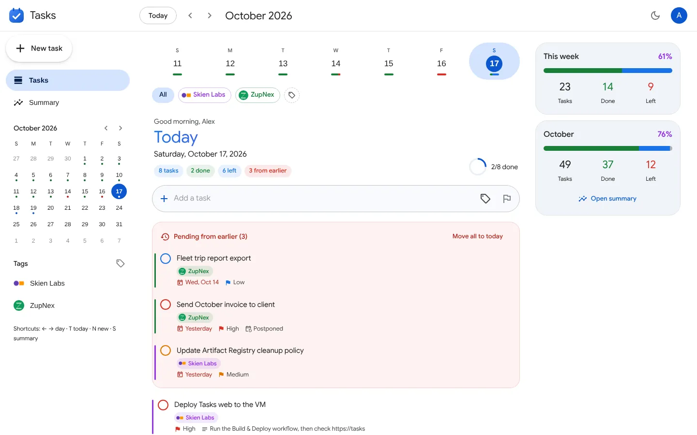
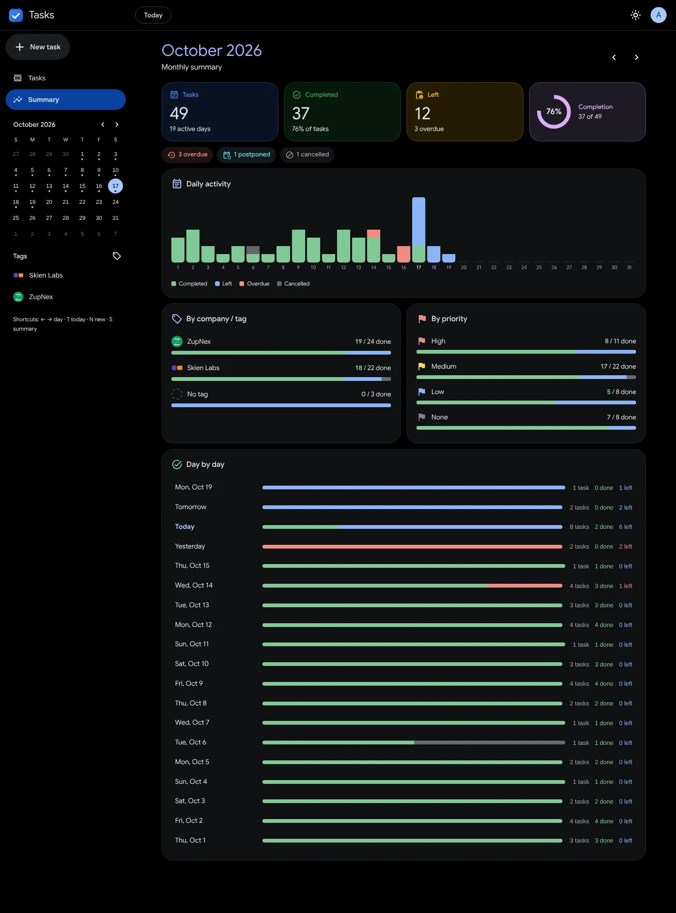
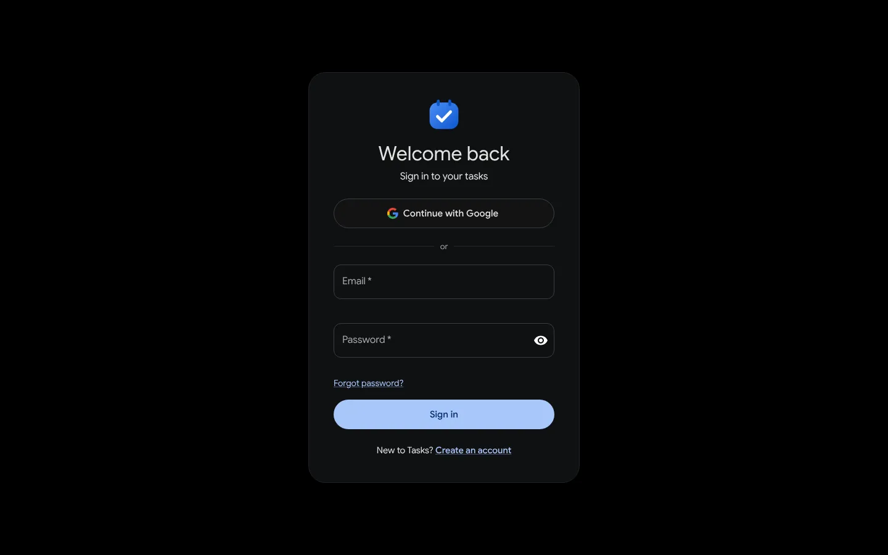
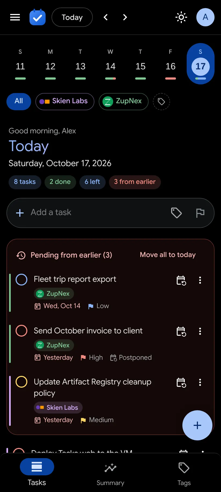
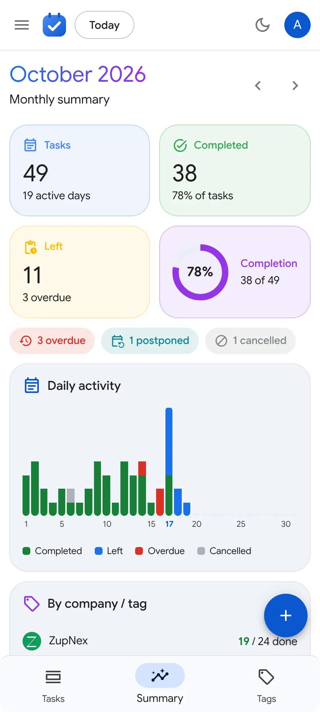
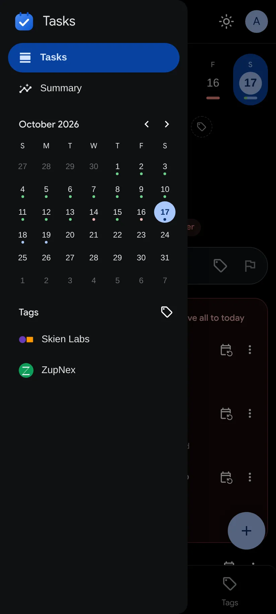

# Tasks

Daily task planner: calendar days, priorities, company tags, carry-over of unfinished work, and monthly summaries.

```
tasks/
├── web/                 Web app (one Docker container)
│   ├── client/          React + Material UI front end (installable PWA)
│   ├── server/          Node + Fastify API, SQLite database
│   ├── config/          Firebase web config example (real file stays on the server)
│   ├── Dockerfile
│   └── docker-compose.yml   compose file for the VM (~/docker/apps/tasks)
├── app/                 Android app (coming later; will use the same API)
├── docs/screens/        screenshots of the web app
└── .github/workflows/
    ├── ci.yml           tests + Docker build on every push / PR
    └── deploy-web.yml   build → push to GAR → deploy to VM (run manually)
```

## Screens

| Today (AMOLED dark) | Today (light) |
| --- | --- |
|  |  |
| **Monthly summary** | **Sign in** |
|  |  |

<p>
  
  
  
</p>

All screens are in [docs/screens](docs/screens).

## Docs

- Web app setup, deployment and API: [web/README.md](web/README.md)
- Android app: [app/README.md](app/README.md)
